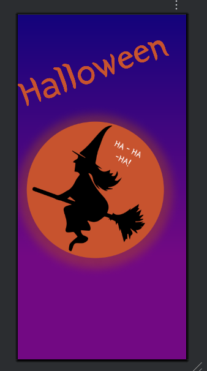
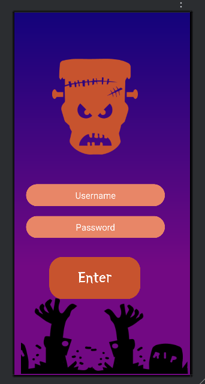
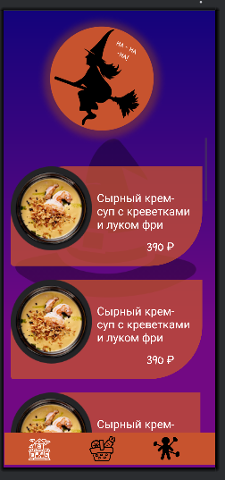
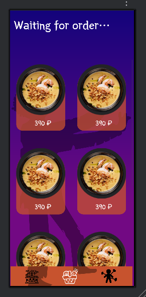
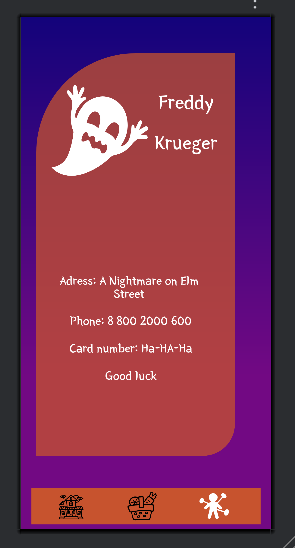

# Halloween Shop UI

Многостраничный интерфейс приложения-магазина, сверстанный на основе макета из Figma. Проект посвящен отработке навыков создания сложных экранов в Android.

## Скриншоты

## Главный экран

## Окно авторизации

## Меню

## Корзина

## Профиль

## Стек

- **Язык:** Java
- **UI:** XML, ConstraintLayout, ScrollView, RecyclerView
- **Ресурсы:** Кастомные drawable (фоны, кнопки), стили, цвета

## Что реализовано
- Перенос дизайна из Figma в нативный Android XML
- Верстка карточек товаров с изображениями и ценами
- Использование кастомных фонов и элементов дизайна
- Плавный скролл контента на всех экранах

